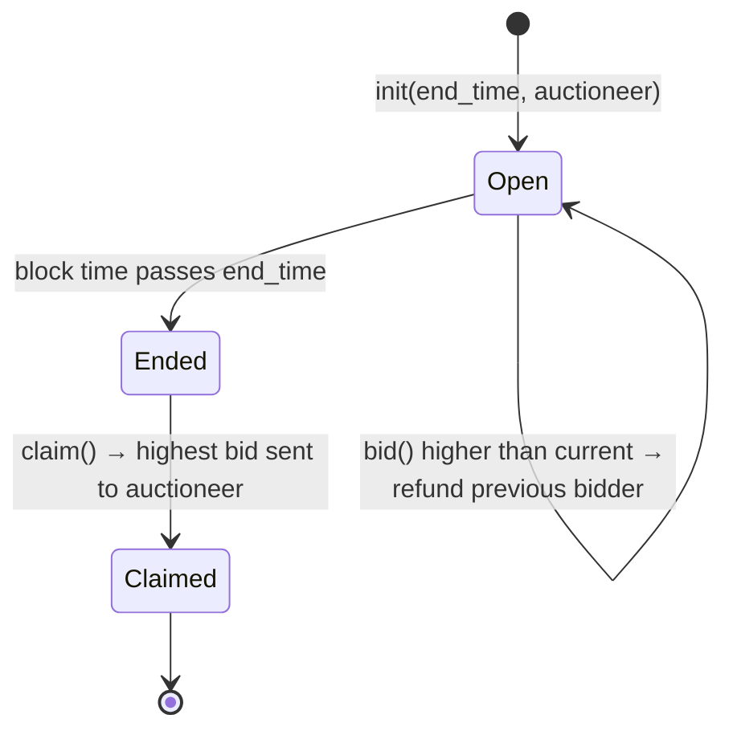

# NEAR Auction: contract + web client

A simple English auction on [NEAR Protocol](https://docs.near.org), written in Rust with
[`near-sdk`](https://docs.near.org/sdk/rust/introduction), plus a browser client in
[`frontend/`](frontend) that lets anyone with a NEAR **testnet** account bid and claim.

It is based on the [Basic Auction tutorial](https://docs.near.org/tutorials/auction/basic-auction).

| | |
|---|---|
| Network | testnet |
| Contract account | [`subhdotsol.testnet`](https://testnet.nearblocks.io/address/subhdotsol.testnet) |
| Auctioneer | `subhdotsol.testnet` |
| Auction ends | `1794240000000000000` ns = 2026-11-09 16:00 UTC |

---

## What the contract does

The contract runs **one** auction for NEAR tokens:

1. **`init`**: the deployer sets the end time and the *auctioneer* (the account that gets the money).
   The starting "highest bid" is 1 yoctoNEAR, held by the contract account itself.
2. **`bid`**: until the end time, any account can attach NEAR to a `bid` call. If the attached
   amount is higher than the current highest bid, it becomes the new highest bid and the
   **previous bidder is refunded automatically** in the same transaction. A lower or equal bid fails
   and the attached NEAR goes back to the sender.
3. **`claim`**: after the end time, anyone can call `claim` **once** to send the winning bid to the
   auctioneer.



### Methods

| Method | Kind | Arguments | Deposit | Fails when |
|---|---|---|---|---|
| `init` | init (once) | `end_time: U64` (ns), `auctioneer: AccountId` | none | contract already initialized |
| `bid` | change, `#[payable]` | none | the bid amount | auction ended; deposit ≤ current highest bid |
| `claim` | change | none | none | auction not ended yet; already claimed |
| `get_highest_bid` | view | none | none | n/a. Returns `{ "bidder": string, "bid": "<yoctoNEAR>" }` |
| `get_auction_end_time` | view | none | none | n/a. Returns nanoseconds as a string |
| `get_auctioneer` | view | none | none | n/a |
| `is_already_claimed` | view | none | none | n/a |

**View** methods are free reads served by any RPC node; no wallet or signature needed.
**Change** methods are transactions: they must be signed by an account and cost a small amount of gas.

### Things to know

- **Units.** Amounts are in yoctoNEAR (1 NEAR = 10²⁴ yoctoNEAR). Times are Unix timestamps in
  **nanoseconds** (NEAR block time). `U64` and `NearToken` are sent as JSON strings because
  JavaScript numbers cannot represent them exactly.
- **One auction per deployment.** `init` can only run once (`#[derive(PanicOnDefault)]` + `#[init]`).
  For a new auction, deploy to a new account (see [Deploy your own auction](#deploy-your-own-auction)).
- **Refunds are fire-and-forget.** The refund in `bid` and the payout in `claim` are not checked by a
  callback. If the receiving account was deleted, those tokens are lost. Fine for learning; a
  production auction should use a withdrawal pattern or callbacks (see comments in `src/lib.rs`).
- **No item.** The contract only moves NEAR; nothing is transferred to the winner. The
  [tutorial's later chapters](https://docs.near.org/tutorials/auction/introduction) add NFTs and FTs.

---

## Repository layout

```text
.
├── src/lib.rs              # the contract + unit tests
├── tests/test_basics.rs    # integration test against a local NEAR sandbox
├── Cargo.toml              # Rust crate + reproducible-build settings for cargo-near
├── .github/workflows/      # CI: test on push, deploy staging/production
└── frontend/               # browser client (Vite + TypeScript, no framework)
    ├── index.html          # page layout
    ├── .env.example        # VITE_CONTRACT_ID: which contract the UI talks to
    └── src/
        ├── config.ts       # network, contract id, RPC + explorer URLs, gas
        ├── near.ts         # all blockchain code: deployment check, views, wallet, bid/claim
        ├── main.ts         # UI rendering and event handlers
        └── style.css
```

---

## Frontend

Plain TypeScript with [Vite](https://vite.dev). It uses the libraries recommended in the
[NEAR wallet login docs](https://docs.near.org/web3-apps/tutorials/wallet-login):

- [`near-api-js`](https://github.com/near/near-api-js) `JsonRpcProvider` for view calls and account lookups.
- [`@hot-labs/near-connect`](https://github.com/azbang/near-connect) for the wallet picker
  (Meteor, Intear, Ledger, Nightly, NEAR CLI, ...) and transaction signing. The page never sees
  private keys; the wallet signs.

### Run it

Requires Node.js 22.22+.

```bash
cd frontend
npm install
npm run dev        # http://localhost:5173
```

`npm run build` writes a static site to `frontend/dist/`, which any static host can serve
(Vercel, Netlify, GitHub Pages, ...).

### What the page does

1. **Deployment check.** On load it checks, step by step, that the contract is live on testnet:
   - the account exists (`view_account` RPC query),
   - it has contract code (`code_hash` is not the all-zero hash `1111…1111`),
   - the code is this auction and `init` has been called (the auction's view methods answer).

   Each failure says what to do next: create the account, deploy, or initialize.
   Code: `checkDeployment()` in [`frontend/src/near.ts`](frontend/src/near.ts).
2. **Auction state.** Highest bid, bidder, auctioneer, end time with a live countdown. It re-reads the
   contract every 15 s, so bids from other people show up.
3. **Wallet.** "Connect wallet" opens the wallet picker, locked to testnet. The session is restored
   on reload.
4. **Bid.** Enter an amount in NEAR higher than the current bid. That NEAR is attached to the `bid` call.
5. **Claim.** Enabled once the auction has ended and nobody has claimed yet.
6. **Activity.** Every transaction is logged with a link to [NearBlocks testnet](https://testnet.nearblocks.io).
   Contract errors such as `You must place a higher bid` are shown as-is.

### Point it at another contract

By default the UI talks to `subhdotsol.testnet`. To change that:

- per visit: `http://localhost:5173/?contract=my-auction.testnet`
- per build: `cp .env.example .env`, then set `VITE_CONTRACT_ID=my-auction.testnet`

### Using it as a bidder

You need a testnet account with test NEAR. Testnet NEAR has no value and is free:

- create one in a wallet that supports testnet, e.g. [Meteor Wallet](https://wallet.meteorwallet.app)
  (switch it to testnet), or
- with the CLI: `near account create-account sponsor-by-faucet-service <name>.testnet autogenerate-new-keypair save-to-keychain network-config testnet create`

---

## Contract development

### Prerequisites

- Rust (version pinned in `rust-toolchain.toml`, with the `wasm32-unknown-unknown` target)
- [`cargo-near`](https://github.com/near/cargo-near): build and deploy
- [`near` CLI](https://near.cli.rs): accounts and contract calls

### Build

```bash
cargo near build
```

Output: `target/near/hello_world.wasm` (+ ABI).

### Test

```bash
cargo test
```

Runs the unit tests in `src/lib.rs` and `tests/test_basics.rs`. The second one builds the
contract, starts a local NEAR sandbox, and goes through bidding, refunds, the time limit and claiming.

### Deploy your own auction

1. **Create a testnet account for the contract** (faucet-funded):

   ```bash
   near account create-account sponsor-by-faucet-service my-auction.testnet \
     autogenerate-new-keypair save-to-keychain network-config testnet create
   ```

2. **Pick an end time** in nanoseconds:

   ```bash
   # macOS
   END_TIME=$(date -v+1d +%s000000000)        # 1 day from now
   # Linux / WSL
   END_TIME=$(date -d '+1 day' +%s000000000)
   ```

3. **Deploy and initialize in one transaction:**

   ```bash
   cargo near deploy build-non-reproducible-wasm my-auction.testnet \
     with-init-call init json-args "{\"end_time\": \"$END_TIME\", \"auctioneer\": \"<AUCTIONEER>.testnet\"}" \
     prepaid-gas '30.0 Tgas' attached-deposit '0 NEAR' \
     network-config testnet sign-with-keychain send
   ```

   Use `build-reproducible-wasm` instead for a verifiable production build (needs Docker).
   If you already deployed with `without-init-call`, initialize separately:

   ```bash
   near contract call-function as-transaction my-auction.testnet init \
     json-args "{\"end_time\": \"$END_TIME\", \"auctioneer\": \"<AUCTIONEER>.testnet\"}" \
     prepaid-gas '30.0 Tgas' attached-deposit '0 NEAR' \
     sign-as my-auction.testnet network-config testnet sign-with-keychain send
   ```

4. **Check it:** open the frontend with `?contract=my-auction.testnet`; all three deployment
   checks should be green. Or from the CLI:

   ```bash
   near contract call-function as-read-only my-auction.testnet get_highest_bid json-args {} network-config testnet now
   ```

### CLI interaction (without the frontend)

```bash
# bid 1 NEAR
near contract call-function as-transaction subhdotsol.testnet bid json-args {} \
  prepaid-gas '30.0 Tgas' attached-deposit '1 NEAR' \
  sign-as <YOU>.testnet network-config testnet sign-with-keychain send

# claim after the end time
near contract call-function as-transaction subhdotsol.testnet claim json-args {} \
  prepaid-gas '30.0 Tgas' attached-deposit '0 NEAR' \
  sign-as <YOU>.testnet network-config testnet sign-with-keychain send
```

### CI/CD

`.github/workflows/` runs the tests, then deploys a staging copy (`gh-<PR number>.<staging account>`)
for each pull request and removes it when the PR closes. Pushes to `main` run the tests and deploy
to production. Accounts, networks and keys come from the repository variables and secrets named in
those files.

---

## Useful links

- [NEAR documentation](https://docs.near.org)
- [NEAR Rust SDK](https://docs.near.org/sdk/rust/introduction)
- [Wallet login in web apps](https://docs.near.org/web3-apps/tutorials/wallet-login)
- [cargo-near](https://github.com/near/cargo-near) and [near CLI](https://near.cli.rs)
- [NearBlocks testnet explorer](https://testnet.nearblocks.io)
- [NEAR Discord](https://near.chat) · [NEAR dev Telegram](https://t.me/neardev)
